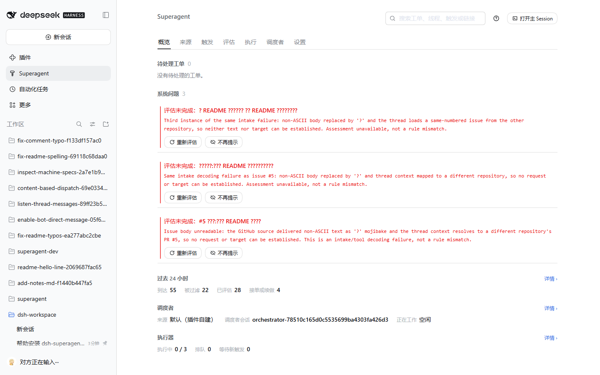
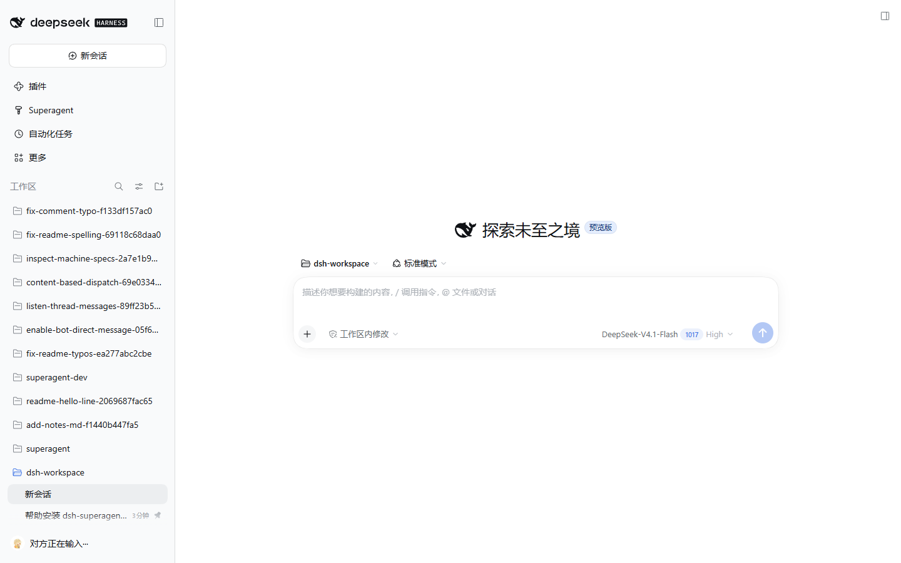
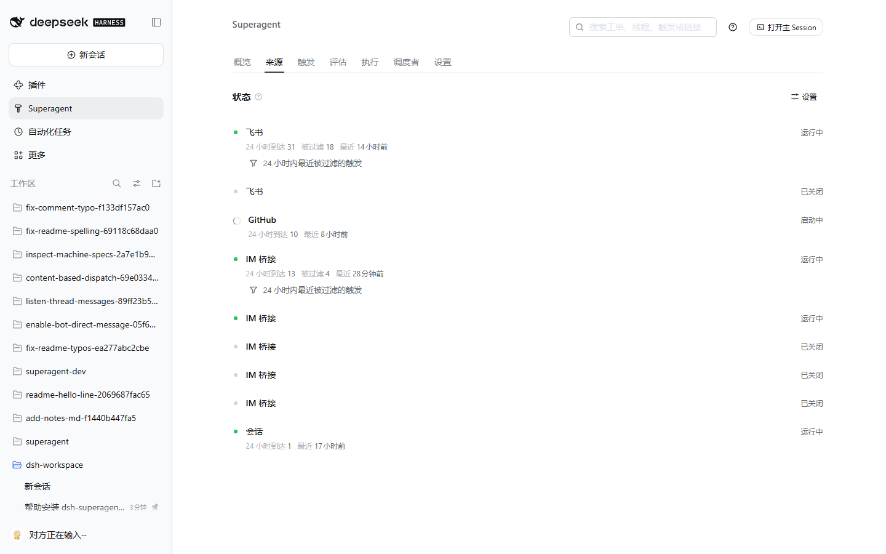

# dsh-superagent

**Language:** [中文](README.md) · **English**

> **Research prototype for reference only, not an official DeepSeek product.** This code grew out of our team's day-to-day development work, with much of the engineering done by coding agents. Treat it as research code, not production-ready software. It may still contain bugs, and its coding style and engineering practices may be inconsistent. Review and adapt it before using it in your own environment.
>
> We have adapted it for publication, so it is not identical to our internal version or the implementation described in *Exploring Super-agent Design: Towards a More Autonomous Agent System*. Some designs discussed in the article are directions for future development and are not implemented in this prototype.

dsh-superagent is a proactive coding agent for GitHub repositories, packaged as a bundle for [DeepSeek Harness](https://www.deepseek.com/en/harness/). It listens to GitHub and, optionally, Feishu, DingTalk or WeCom. When someone allowed asks the agent for work, it opens a work item, works on it in its own agent session and directory, and answers in the original conversation, for example with a pull request. A web panel shows what needs a person.

It is also a way of working with an agent: **take as little human attention as possible, and give as much value as possible.** An agent that can act for a whole team can also waste a whole team's attention, so it acts only when asked or when a rule the team wrote allows it, and speaks only when someone must act or can use a result. [docs/000-philosophy.md](docs/000-philosophy.md) explains the principle and what it asks of the operator.

## Setup

Setup has many steps, so an agent does it with you. Ask your coding agent:

> Read SETUP.md in this repository and set up dsh-superagent with me.

It asks one short question at a time, shows the full plan once, and then installs and configures everything. [SETUP.md](SETUP.md) is what it follows.

## Documentation

Read the numbered documents in order; each builds only on the ones before it.

- [000 Philosophy](docs/000-philosophy.md)
- [001 Domain model](docs/001-domain.md)
- [002 Authorization](docs/002-authorization.md)
- [003 Execution](docs/003-execution.md)
- [004 Prompts](docs/004-prompts.md)
- [005 Panel](docs/005-panel.md)
- [006 Deployment](docs/006-deployment.md): manual setup, configuration, upgrades and troubleshooting
- [007 Architecture](docs/007-architecture.md)
- [008 Cookbook](docs/008-cookbook.md): adding a Source
- [009 IM bridge](docs/009-im-bridge.md): reaching another chat tool through a bridge adapter
- [010 Session bus](docs/010-session-bus.md): reading other Sessions, and handing work to other agents
- [011 Extensions](docs/011-extensions.md): growing the agent without changing its core
- [012 Dispatcher](docs/012-dispatcher.md): designating the Session that judges and assigns work
- [013 Multi-repository](docs/013-multi-repository.md): the stage plan behind this fork
- [014 Progress](docs/014-progress.md): what was built, what was verified, what is still open

## Supervise other Sessions

The main Session can list, read and search the Sessions on this machine (`orchestrator_session_*`) and hand work to an
installed agent such as Codex or Claude Code (`orchestrator_agent_*`). Transcripts are read where the format is public;
any other agent is used through its non-interactive command. See [010 Session bus](docs/010-session-bus.md).

## Add a chat tool

The **IM bridge** Source reaches any chat tool without touching the core: write one process that speaks the JSON-lines
protocol in [009 IM bridge](docs/009-im-bridge.md), start from `examples/im-bridges/template.mjs`, and point the Source at
it. `examples/im-bridges/telegram.mjs` is a complete adapter with no dependencies; `dingtalk-stream.mjs` and `wecom.mjs`
cover the two Chinese enterprise tools.

## Development

`pnpm check` runs the typecheck, the tests and the build.

## License

[MIT](LICENSE)

## What this fork adds

This repository started from the DeepSeek Harness prototype and has since grown multi-repository and multi-source support, all verified on a
live instance:

| Area | What changed |
|---|---|
| Multi-repository | A ticket records the repository it works in. Listing polls run over every served repository, each with its own cursor; worktrees land under `<root>/<owner>/<name>/`; pull requests and replies are read and written in the ticket's repository; the Thread key names its repository (`github:owner/name#5`) while the default repository keeps `github:5`. |
| Multi-instance chat sources | One kind can run several instances (two DingTalk bots, a second Feishu app, a WeCom bridge). Each instance has its own loop, its own bridge process, its own credentials through `config.env`, and its own health. |
| DingTalk | A Stream-mode bridge (`examples/im-bridges/dingtalk-stream.mjs`): an outbound WebSocket to DingTalk's gateway, so no public callback URL and no tunnel are needed. |
| WeCom | `examples/im-bridges/wecom.mjs` with a self-check suite (signature, decryption, corp check). |

Single-repository deployments behave exactly as before: the default repository keeps its thread keys, cursor keys, worktree path and channel
address, byte for byte.

## Known issues

Published so the next version has something to fix; none of these blocks a single-repository, single-instance deployment.

1. **Per-instance health is shared.** Health entries are claimed per kind, so several *enabled* instances of one kind show one line. A disabled
   instance no longer writes into it (that used to make healthy siblings look broken), so what remains is cosmetic: you cannot tell which
   instance the line came from.
2. **A second DingTalk bot has not received a message end to end.** Both bridges connect with their own credentials and DingTalk delivers to
   both (captured from standalone bridges), but messages for the second instance have not yet appeared in its counters. The diagnosis in
   progress is recorded in [docs/014-progress.md](docs/014-progress.md).
3. **A long-idle Stream connection is not re-established.** If DingTalk closes an idle connection without the client noticing, the bridge keeps
   running with a dead socket until the plugin restarts. A keepalive has not been implemented.
4. **The pull-request poll reads a bare number.** `follows` stores numbers, so two repositories with the same pull-request number can be
   confused; the Thread carries its repository but the follow does not yet.

## Screenshots

The panel, captured from a running instance. The workspace list on the left is blurred, since it names this machine's own work.

- **Overview** — pending tickets, problems that need a person, and the last 24 hours (arrived, filtered, assessed, accepted). The red block
  is an assessment that could not run, with its reason.
- **Workspace** — tickets appear as workspaces, each with its own directory.

