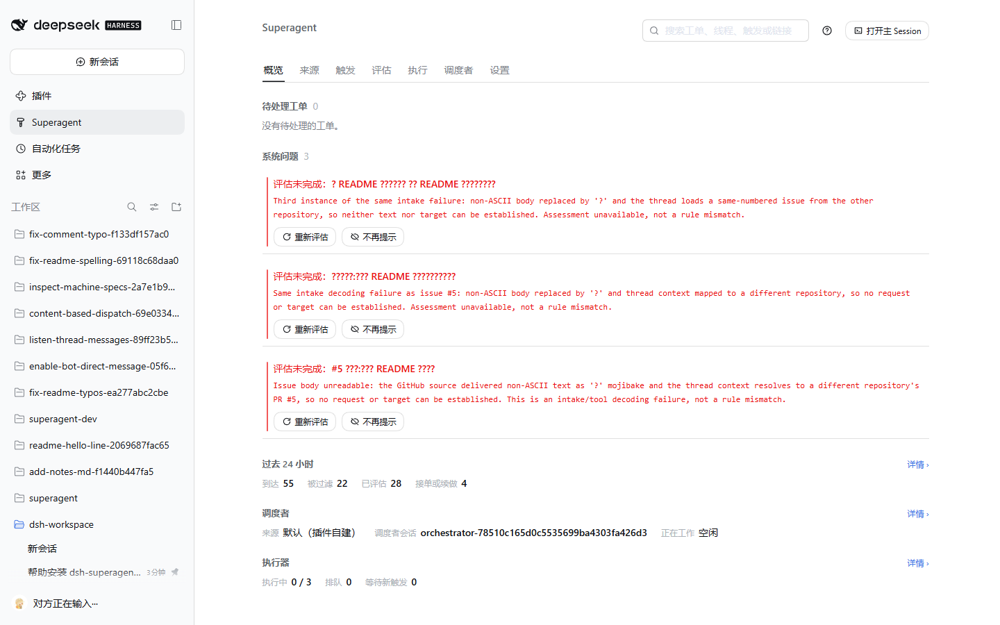
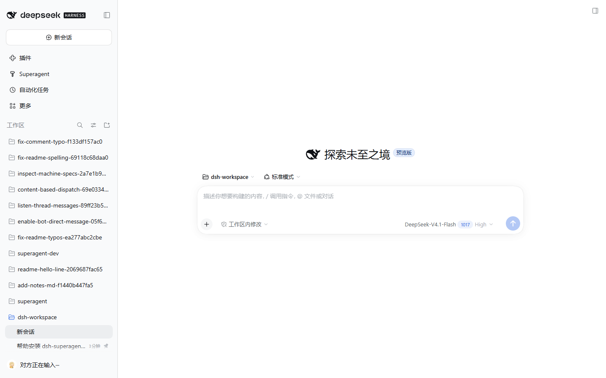
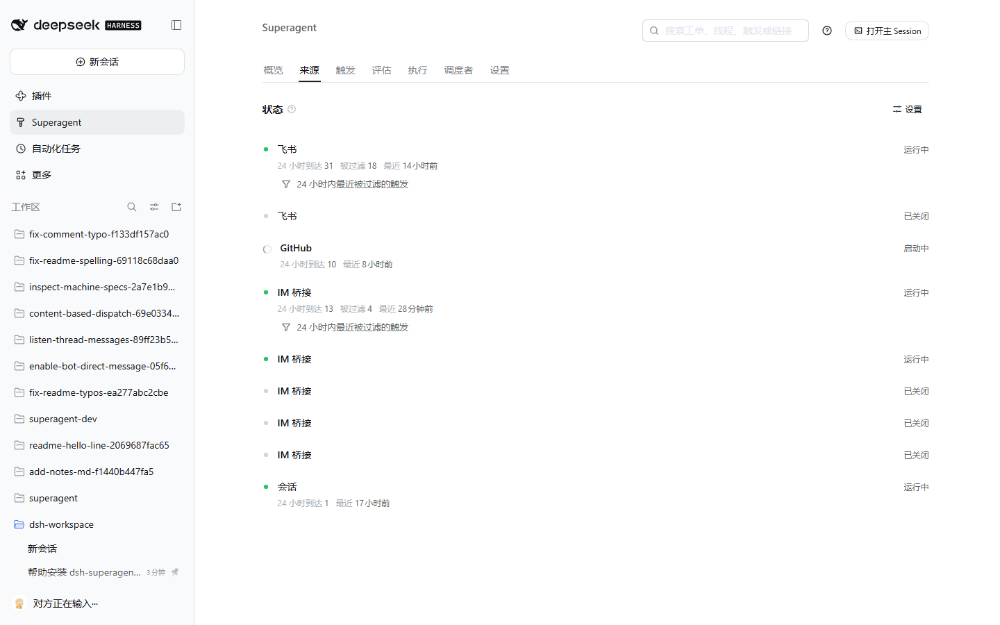

# dsh-superagent

**语言：** **中文** · [English](README.en.md)

> **仅供参考的研究原型，不是 DeepSeek 官方产品。** 这份代码来自我们团队日常开发中的实践，其中相当一部分工程工作由编码智能体完成。请把它当作研究代码，而不是可直接上生产的软件：它可能仍有缺陷，代码风格与工程实践也可能不一致。在把它用于你自己的环境之前，请先通读并改造。
>
> 为了公开发布我们做过调整，因此它既不等于我们内部的版本，也不等于《Exploring Super-agent Design: Towards a More Autonomous Agent System》一文里描述的实现。文中讨论的部分设计属于后续方向，本原型并未实现。

dsh-superagent 是一个**主动式的编码智能体**，以 [DeepSeek Harness](https://www.deepseek.com/en/harness/) 的 bundle 形式发布。它监听 GitHub，可选地监听飞书、钉钉、企业微信。当有权限的人向它提出工作请求时，它开一张工单，在**自己的会话与目录**里干活，并回到原来的对话里回话——例如给出一个 PR。另有一个网页面板，告诉你哪些事需要人来处理。

它同时也是一种与智能体协作的方式：**尽量少占用人的注意力，尽量多交付价值。** 一个能为整个团队行动的智能体，同样也能消耗整个团队的注意力，所以它只在被要求、或被团队写下的规则允许时才行动，只在必须有人处理、或有人能用上结果时才开口。[docs/000-philosophy.md](docs/000-philosophy.md) 说明了这条原则以及对运营者提出了什么要求。

## 安装

安装步骤较多，因此由智能体陪你一起做。对你的编码智能体说：

> 读取本仓库的 SETUP.md，和我一起安装 dsh-superagent。

它会一次只问一个简短问题，先把完整计划给你看一遍，然后再安装与配置。[SETUP.md](SETUP.md) 是它遵循的步骤。

## 文档

按编号顺序阅读，每一篇只依赖它前面的那些。

- [000 理念](docs/000-philosophy.md)
- [001 领域模型](docs/001-domain.md)
- [002 授权](docs/002-authorization.md)
- [003 执行](docs/003-execution.md)
- [004 提示词](docs/004-prompts.md)
- [005 面板](docs/005-panel.md)
- [006 部署](docs/006-deployment.md)：手工安装、配置、升级与排障
- [007 架构](docs/007-architecture.md)
- [008 烹饪手册](docs/008-cookbook.md)：新增一个来源
- [009 IM 桥](docs/009-im-bridge.md)：通过桥接适配器接入其它聊天工具
- [010 会话总线](docs/010-session-bus.md)：读取其它会话，把工作交给别的智能体
- [011 扩展](docs/011-extensions.md)：不修改内核地扩展这个智能体
- [012 调度者](docs/012-dispatcher.md)：指定那个负责判定与派活的会话
- [013 多仓库](docs/013-multi-repository.md)：本分叉的分阶段实现计划
- [014 进度](docs/014-progress.md)：做了什么、验证了什么、还开着什么

## 监管其它会话

主会话可以列出、读取、搜索本机的会话（`orchestrator_session_*`），并把工作交给已安装的智能体，例如 Codex 或 Claude Code（`orchestrator_agent_*`）。凡是格式公开的会话记录都直接读取，其它智能体则通过它的非交互命令调用。详见 [010 会话总线](docs/010-session-bus.md)。

## 接入一个聊天工具

**IM 桥**这个来源让你不碰内核就能接入任意聊天工具：写一个进程，实现 [009 IM 桥](docs/009-im-bridge.md) 里的 JSON-lines 协议，从 `examples/im-bridges/template.mjs` 起步，然后把来源指向它。`examples/im-bridges/telegram.mjs` 是一个零依赖的完整适配器；`dingtalk-stream.mjs` 与 `wecom.mjs` 覆盖国内两个企业级工具。

## 开发

`pnpm check` 会依次运行类型检查、测试与构建。

## 许可证

[MIT](LICENSE)

## 本分叉新增了什么

本仓库从 DeepSeek Harness 的原型起步，之后长出了多仓库与多源能力，均已在真实实例上验证：

| 方面 | 变化 |
|---|---|
| 多仓库 | 工单会记下自己在哪个仓库干活。列表轮询遍历**每一个**被服务的仓库，各自持有游标；worktree 落在 `<root>/<owner>/<name>/` 下；PR 与回话都在工单自己的仓库里读写；线程键带上仓库名（`github:owner/name#5`），而默认仓库仍保持 `github:5`。 |
| 多实例聊天来源 | 同一个类型可以跑多个实例（两个钉钉机器人、第二个飞书应用、一个企业微信桥）。每个实例有自己的循环、自己的桥进程、通过 `config.env` 携带的自己的凭据，以及自己的健康状态。 |
| 钉钉 | Stream 模式桥（`examples/im-bridges/dingtalk-stream.mjs`）：主动向钉钉网关发起 WebSocket，因此**不需要公网回调地址，也不需要隧道**。 |
| 企业微信 | `examples/im-bridges/wecom.mjs`，带自检用例（签名、解密、企业 ID 校验）。 |

单仓库部署的行为与改造前**逐字节一致**：默认仓库的线程键、游标键、worktree 路径与 channel 地址都没有变。

## 已知问题

这一版先带问题发布，下一版修复；下列各条都不影响「单仓库 + 单实例」的部署。

1. **多实例共用同一条健康记录。** 健康条目按**类型**登记，因此同一类型下多个**已启用**的实例会显示成一行。已停用的实例不再写入（此前它会把健康的兄弟实例显示成故障），所以剩下的只是展示问题：分不清这一行来自哪个实例。
2. **同一类型的多个实例共用一个计数器。** 第二个钉钉实例的入站其实正常（日志里 `receive="stored"`），但它的 `received` 一直显示 0，
   而消息在被 @ 的那个实例上计入。计数与健康条目一样是按类型、而不是按实例记录的。
3. **长时空闲的 Stream 连接不会自动重建。** 如果钉钉在客户端察觉不到的情况下关掉了空闲连接，桥会带着一个死掉的 socket 继续跑，直到插件重启。keepalive 尚未实现。
4. **PR 轮询读的是裸编号。** `follows` 里存的是数字，因此两个仓库的同号 PR 可能混淆；线程已经带上了仓库，`follows` 还没有。

## 截图

下面是在运行中的实例上抓的面板。左侧工作区列表已打码，因为它写的是本机自己的工作内容。

- **概览** —— 待处理工单、需要人处理的问题、以及过去 24 小时的流量（到达、被过滤、已评估、接单或续做）。红色那块是**评估未能进行**的条目，附带了原因。
- **工作区** —— 工单以工作区的形式出现，每个都有自己的目录。

